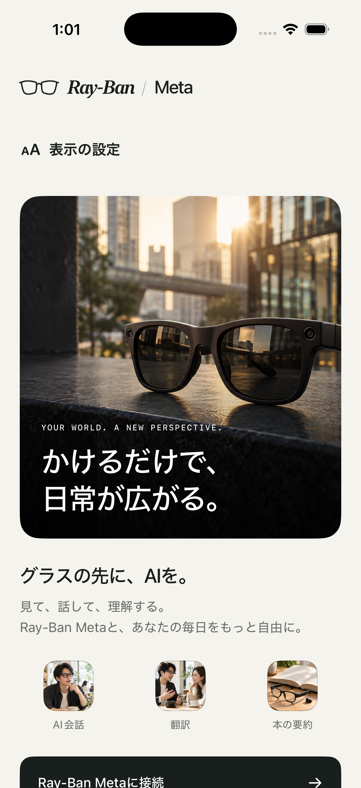
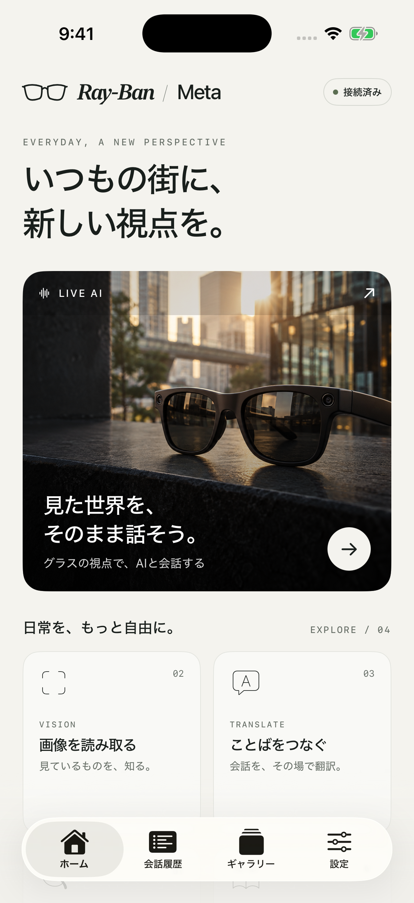
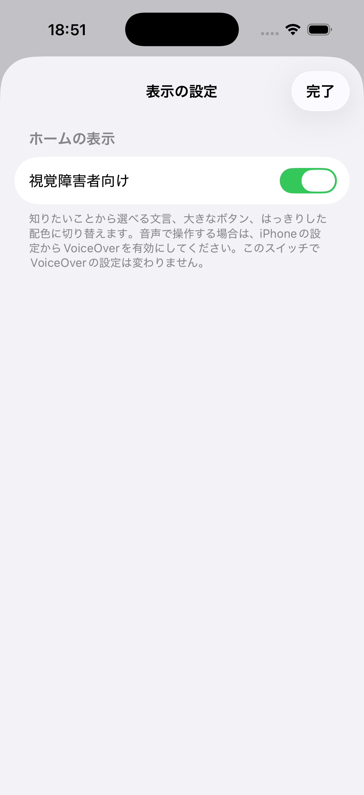
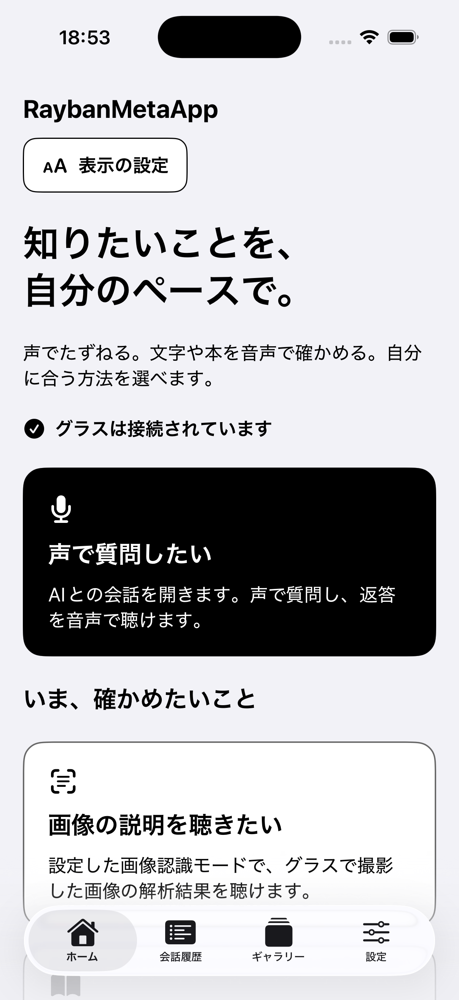

# RaybanMetaApp

**いつもの街に、新しい視点を。**

Ray-Ban Metaのカメラとマイクで、AIとの会話、画像認識、音声翻訳、食事の栄養解析、本の要約を利用するiOSアプリです。[RaybanMeta-OpenAI](https://github.com/2ndarystorage/RaybanMeta-OpenAI)をベースに、[RaybanmetaSummarizeBook](https://github.com/2ndarystorage/RaybanmetaSummarizeBook)の日本語要約・読み上げ機能を統合しています。

  

グラスを主役にした写真表現、アイボリーと墨色、フレームの線画と細線アイコンで画面を統一しました。画像素材はAI生成のコンセプトビジュアルで、公式の商品写真ではありません。[デザインと画像素材の詳細](docs/urban-design.md)

> **現在の状態（2026年10月25日）：** 署名付きビルド、iPhone 15 Proへのインストール・起動、本の要約の自動テスト7件に成功しています。実際の眼鏡との接続とAIサービスへの通信は未検証です。利用にはMetaの接続設定と、ご自身のAPIキーが必要です。

## 画面イメージ

<table>
  <tr>
    <th>ウェルカム</th>
    <th>ホーム</th>
  </tr>
  <tr>
    <td align="center"></td>
    <td align="center"></td>
  </tr>
</table>

iPhoneシミュレータ上で、アプリと同じ画面部品を使って表示を確認したプレビューです。ホームの「接続済み」は表示確認用の値で、実際に眼鏡が接続された記録ではありません。下へスクロールすると残りの機能カードと読書の写真カードが表示されます。

## 視覚障害者向けの表示

**設定 → ホームの表示 → 視覚障害者向け** をオンにすると、ホームの文言・配置・画像を切り替えられます。初期状態はオフです。グラスの接続前も、ウェルカムの **表示の設定** から変更できます。設定は再起動後も保持され、オフにすると通常のデザインへ戻ります。

「知りたいことを、自分のペースで。」を軸に、**声で質問したい／画像の説明を聴きたい／本を短く聴きたい／会話を訳してほしい／食事の内容を知りたい** と、利用者が選びたいことを表現しています。

- 大きなボタンを1列で配置し、iPhoneの文字サイズとライト／ダーク設定に合わせて表示します。
- 写真に文字を重ねず、操作ボタンを優先します。写真は、本人がスマートグラスと音声を使って本の情報に触れる日常の場面へ切り替わります。
- ボタンや写真にはVoiceOver用のラベルと説明を付けています。このスイッチでiPhoneのVoiceOver自体はオンになりません。
- AIの接続先、APIキー、画像認識モードは変更しません。「画像の説明を聴きたい」は設定したQuick Visionモードを利用します。歩行案内や安全確認の機能ではありません。

<table>
  <tr><th>表示の設定</th><th>切り替え後のホーム</th></tr>
  <tr>
    <td align="center"></td>
    <td align="center"></td>
  </tr>
</table>

設定は実アプリのシミュレータ画面、ホームは同じ画面部品を使った表示確認用プレビューです。ホームの接続状態は表示用の例です。[文言・画像・検証の詳細](docs/accessibility-home.md)

## できること

| ホームの入口 | 機能 |
| --- | --- |
| **LIVE AI** | グラスのカメラ・マイクを使ってAIと会話。OpenAI Realtime、Qwen Omni、Gemini Live、Autoを選択できます。 |
| **画像を読み取る** | Quick Visionで見ている場面や文字を解析し、結果を読み上げます。Siriショートカットにも対応しています。 |
| **ことばをつなぐ** | リアルタイム翻訳。原文言語を自動判定し、設定した翻訳先の音声と字幕を出力します。 |
| **食事を記録する** | LeanEatの撮影・栄養解析へ移動し、食事の推定栄養情報やスコアを確認します。 |
| **本の要約を聴く** | 映っているページを日本語で要約し、指定文字数以内の内容を端末の音声合成で読み上げます。 |

会話履歴・ギャラリー・設定は下部のタブから開きます。栄養情報や要約などのAI出力は、実際の食品・原文と照合してください。

## 用意するもの

- iOS 17以降のiPhone。ビルド・インストールにはMacとXcodeが必要です。この版はXcode 26.6で確認しています。
- Meta Wearables DAT SDKに対応するRay-Ban Metaなどの眼鏡と、ペアリングに使うMeta AIアプリ。
- [Meta Wearables Developer Center](https://wearables.developer.meta.com/)で用意したアプリ設定（Meta App ID、Client Tokenなど）。
- 利用するAIサービスのAPIキーとネットワーク接続。

このプロジェクトはDAT SDK **0.5.0** を使用します。本の要約の追加元が使用するSDK 1.0.0へは変更せず、ベースアプリの接続・カメラセッションを共用しています。

## セットアップ

1. このリポジトリを取得し、`CameraAccess.xcodeproj`をXcodeで開きます。Schemeは **TurboMeta** を選択し、Swift Packageの依存解決を待ちます。
2. アプリターゲット **CameraAccess → Signing & Capabilities** で、ご自身の開発用Teamを選びます。Bundle Identifierを変更する場合は、Meta側のアプリ登録も合わせてください。
3. `Config/LocalSecrets.example.xcconfig`を、同じフォルダの`LocalSecrets.xcconfig`へコピーします。`META_APP_ID`と`CLIENT_TOKEN`にご自身の値を設定します。実際の値をREADMEやソースコードへ書き込まないでください。
4. Meta側で、Bundle Identifierとコールバック用URLスキームを登録・確認します。現在のプロジェクトのURLスキームは **`turbometa-openai://`** です。
5. Meta AIアプリで眼鏡をペアリングし、Metaの案内に従って開発用の接続設定を行います。
6. 開発用に設定したiPhoneをXcodeで選び、ビルド・実行します。ウェルカム画面の **Ray-Ban Metaに接続** から登録し、表示される権限要求を確認します。
7. ホームに進んだら、**設定 → OpenAI API Key（画像・栄養・翻訳共通）** でご自身のキーを保存します。

このプロジェクトはベースアプリのBundle IdentifierとURLスキームを引き継いでいます。同じ識別子でインストールすると既存アプリの更新になります。別アプリとして同時に使う場合は、識別子・URLスキーム・Meta側の登録をそれぞれ揃えて変更してください。

Meta SDKの初期化に失敗してもウェルカム画面は表示されます。接続ボタンで設定確認の案内が出る場合は、手順2〜5を確認してください。**Meta設定が完了するまでは、ホームの各機能を利用できません。**

## APIキーの設定

OpenAI用には、設定画面に保存する**1つのキー**を共用します。本の要約用に別のキーを登録する必要はありません。

| 利用先 | 設定・実装上のモデル |
| --- | --- |
| Live AIのOpenAIモード | 共通のOpenAIキー。`gpt-realtime`を利用。 |
| Quick Vision・撮影後の画像認識・LeanEat・本の要約 | 共通のOpenAIキー。`gpt-4.1-mini`を利用。 |
| リアルタイム翻訳 | 共通のOpenAIキー。`gpt-realtime-translate`を利用。翻訳先は設定から選択。 |
| Live AIのQwen Omniモード | Alibaba Cloudのキー。利用する地域の設定も確認。 |
| Live AIのGemini Liveモード | Googleのキー。 |

Live AIの接続先は **設定 → Live AIプロバイダー** で切り替えます。新規インストール時の初期選択はOpenAIです。Autoは会話開始時に、保存済みキーを **OpenAI → Qwen → Gemini** の順で確認して選択します。接続失敗後に別サービスへ自動で切り替わる機能ではありません。

キーはiPhoneのKeychainに保存します。**APIキーをリポジトリへアップロードしないでください。** `Config/LocalSecrets.xcconfig`とビルド生成物はGitの追跡対象外です。画像・音声を送信する機能では、利用先のAPI料金とモデルへのアクセス権が必要です。

## 本の要約の使い方

1. OpenAIキーと眼鏡の接続を設定した後、ホームの **本の要約を聴く** を開きます。下部の「読む時間を、聴く時間に。」の写真カードからも開けます。
2. **映像を開始** を押し、本のページを明るい場所で正面に向けます。プレビューで文字を確認してください。
3. 要約の上限を **50〜1000文字** で指定します。初期値は200文字、50文字刻みです。
4. **このページを要約** を押すと、その時点の映像フレームをOpenAIへ送信します。要約文と対象画像を表示し、日本語で自動読み上げします。
5. **もう一度聴く**、**読み上げ停止** を使えます。解析中は **キャンセル** できます。

文字が小さい場合は、設定の **映像品質 → 高画質** に変更してアプリを再起動してください。

- 読み取る範囲はボタンを押した時点の1画像です。本全体の連続取り込みではありません。文字を十分に読めない場合は再撮影を案内します。
- 文字数は句読点を含むSwiftの`String.count`で数えます。上限を超えると1回だけ再要約し、それでも長ければ端末側で文末または上限で切ります。通常は1回、短縮時は最大2回のAPI呼び出しです。
- 音声は端末で生成し、iPhoneの現在の音声出力先へ再生します。メガネから聴く場合は、Bluetoothの音声出力先を確認してください。
- 映像停止、眼鏡切断、画面を閉じる操作、バックグラウンド移行で、解析と読み上げを停止します。キャンセル後の古い応答から自動再生を再開しません。
- 本の要約機能は、対象画像・本文・要約をファイル保存せず、画面のメモリ内に保持します。

## Live AI・Siriの補助機能

**Hey Turbo：** 設定の **Wake phrase: Hey Turbo** を有効にすると、Live AI画面が前面にある間、対応端末では端末内の英語音声認識で待ち受けます。`en-US`の端末内認識が使えない場合は **Start now** を使用してください。ロック中やシステム全体で使うウェイクワードではありません。

**Function Calling：** OpenAI Realtimeから、端末の現在時刻を取得する`get_current_time`と、カメラ画像の取得状況を確認する`get_camera_frame_status`を利用できます。どちらも読み取り専用です。

**Siriショートカット：** インストール後にアプリを一度開いて初期化し、iPhoneの「ショートカット」アプリで **RaybanMeta OpenAI** の **クイック画像認識** などのアクションを追加します。アプリの表示名は現在「RaybanMeta OpenAI」です。必要に応じてショートカットをアクションボタンなどへ割り当ててください。本の要約専用のSiriアクションは未実装です。

## 困ったときは

| 状況 | 確認すること |
| --- | --- |
| 接続設定の案内が出る | ローカルのMeta App ID・Client Token、Team、Bundle Identifier、URLスキームを確認し、再ビルド。 |
| 眼鏡が接続されない | Meta AIアプリのペアリング、開発用設定、Bluetooth、眼鏡の状態を確認。 |
| AIが返答しない | 機能に対応するキー、選択したプロバイダー、ネットワーク、利用枠・モデルへのアクセス権を確認。 |
| 本の文字を読めない | 明るさ、距離、反射、手ぶれ、映像品質を調整して再試行。 |
| 音声が聞こえない | iPhoneの音量と現在の音声出力先を確認。 |
| バックグラウンドから戻ると映像が止まっている | 本の要約画面で映像を再開。 |
| Xcodeでインストールできない | SigningのTeam、iPhoneの開発用設定、接続状態を確認。 |

## 検証状況

2026年10月25日時点の、このリポジトリの統合版に対する結果です。

| 確認項目 | 結果 |
| --- | --- |
| Xcode 26.6でのiOS向け署名付きDebugビルド | 成功 |
| iPhone 15 Proへのインストール・起動、起動後のプロセス確認 | 成功 |
| ホームとウェルカム画面の表示 | iPhoneシミュレータ上の画面プレビューで確認 |
| 視覚障害者向けの表示 | 実アプリでオン・再起動後の保持、プレビューで通常表示への復帰と読み上げ用ラベルを確認 |
| 本の要約の自動テスト | シミュレータで7件成功。文字数制限、再要約、読み取り失敗、API認証・利用上限、キー未設定、キャンセル後の遅延応答を検証 |
| 実際の眼鏡との接続、カメラ・マイク | 未検証 |
| OpenAI・Qwen・Geminiへの実際の通信 | 未検証。要約テストでは模擬通信を使用 |
| 日本語の読み上げと眼鏡へのBluetooth音声出力 | 実環境では未検証 |

確認時のビルドにはMeta App IDとClient Tokenを設定していません。インストールと起動の成功は、眼鏡を使う各機能の動作保証ではありません。

## 対応範囲・データの扱い

- 今回の本の要約・ホームデザイン・OpenAI連携の変更は**iOS版**が対象です。Androidの既存コードも収録していますが、同等の機能追加・検証はしていません。[Android版の参考資料](android/README.md)
- iOSではOpenClaw、RTMP配信、単独ライブ配信は提供していません。
- 本の要約は日本語固定です。他のAI機能の出力言語は設定を確認してください。今回追加したホームとウェルカムのコピーも日本語を中心としています。
- 解析する画像・音声は各機能のAPIサービスへ送信されます。保存やデータの扱いは利用するサービスの条件も確認してください。上記の「ファイル保存しない」という説明は本の要約機能についてのものです。
- 一般配布する場合は、共有APIキーをアプリへ埋め込まず、バックエンド経由の認証・課金管理を検討してください。

## ベース・参考資料

- ベースアプリ：[RaybanMeta-OpenAI](https://github.com/2ndarystorage/RaybanMeta-OpenAI)（統合時 `488d05d`）
- 本の要約機能：[RaybanmetaSummarizeBook](https://github.com/2ndarystorage/RaybanmetaSummarizeBook)（参照時 `8c6a795`）
- 元プロジェクト：[Turbo1123/turbometa-rayban-ai](https://github.com/Turbo1123/turbometa-rayban-ai)
- SDK：[Meta Wearables DAT iOS](https://github.com/facebook/meta-wearables-dat-ios)
- デザイン・画像生成条件：[urban-design.md](docs/urban-design.md)
- 元プロジェクト由来の資料：[English](README_EN.md) · [简体中文](README_ZH.md)。現在のiOS版の説明・画面と一致しない箇所があります。最新版の説明はこの日本語READMEを参照してください。

旧デザインの画像は元資料との参照を保つため残していますが、このREADMEでは現在の画面プレビューを使用しています。

## ライセンス

元プロジェクトのMITライセンスは[LICENSE](LICENSE)を参照してください。Meta SDKと由来するコードにはMetaの利用条件も適用されます。元プロジェクトの作者と、統合元・SDKの開発者に感謝します。
