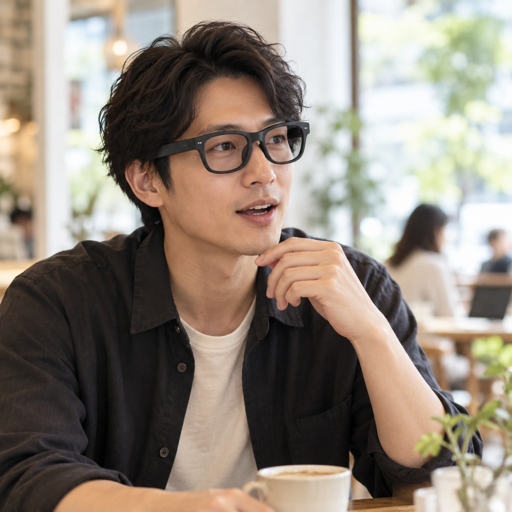
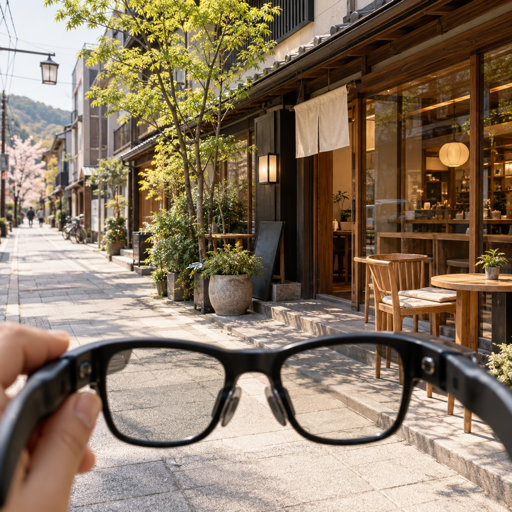
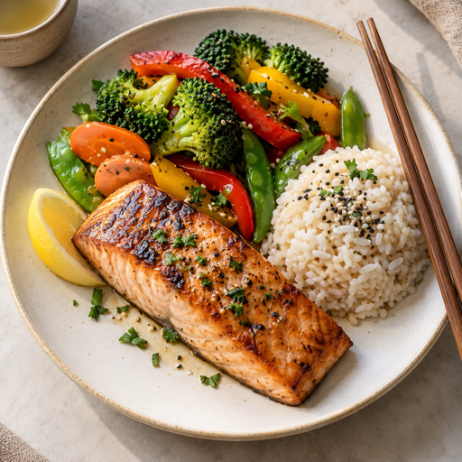
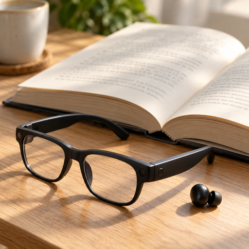

# 利用場面を表す画像アイコン

2026年10月26日

ホームの5機能を、利用場面を表す実写調の画像へ変更しました。通常表示と視覚障害者向け表示で同じ画像を使い、ウェルカムの機能紹介にも共用しています。写真はAI生成のイメージで、公式の商品写真や実際の利用記録ではありません。

| 機能 | 画像 | 保存先 |
| --- | --- | --- |
| AIとの会話 |  | `CameraAccess/Assets.xcassets/UseCaseConversation.imageset/image.png` |
| 景色・画像の読み取り |  | `CameraAccess/Assets.xcassets/UseCaseVision.imageset/image.png` |
| 外国語の翻訳 |  | `CameraAccess/Assets.xcassets/UseCaseTranslation.imageset/image.png` |
| 食事の栄養解析 |  | `CameraAccess/Assets.xcassets/UseCaseNutrition.imageset/image.png` |
| 本の要約 |  | `CameraAccess/Assets.xcassets/UseCaseBook.imageset/image.png` |

機能名・VoiceOverのラベル・遷移先は維持しています。機能名を補うサムネイル画像はVoiceOverから除外し、画像とボタン名が重複して読み上げられないようにしています。接続状況や表示設定、タブなどの操作記号は引き続きシステムのシンボルを使います。

## 生成条件

組み込みの`image_gen`ツールで5画像を個別に生成しました。色調と構図の条件を共通化し、システムの画像変換ツールで512×512ピクセルのアプリ素材へ書き出しています。

### AIとの会話

Use case: photorealistic-natural. Asset type: square photographic image icon for one function in a refined smart-glasses iPhone app. Realistic editorial photography, natural soft daylight, warm ivory and restrained charcoal palette, clear central subject, bold and uncluttered composition readable at 80 pixels. Keep the important subject within the central 70 percent for icon crops. No text, no readable lettering, no logos, no graphics, no interface, no watermark. This is a photograph, not a drawn symbol. Scene: a Japanese adult wearing matte black wayfarer smart glasses, speaking naturally to a voice assistant while sitting at a bright modern cafe table. Medium close portrait, relaxed expression, mouth slightly open, hand resting naturally. Make the black smart glasses and act of speaking clearly visible. Respectful ordinary everyday moment.

### 景色・画像の読み取り

Use case: photorealistic-natural. Asset type: square photographic image icon for one function in a refined smart-glasses iPhone app. Realistic editorial photography, natural soft daylight, warm ivory and restrained charcoal palette, clear central subject, bold and uncluttered composition readable at 80 pixels. Keep the important subject within the central 70 percent for icon crops. No text, no readable lettering, no logos, no graphics, no interface, no watermark. This is a photograph, not a drawn symbol. Scene: first-person view of a calm Japanese city street with a clearly recognizable storefront, small tree and cafe chair. A pair of black smart glasses held low in the foreground, with the streetscape visible beyond them. Emphasize recognizing the scene and objects, not road crossing or navigation. Crisp meaningful shapes, simple composition.

### 外国語の翻訳

Use case: photorealistic-natural. Asset type: square photographic image icon for one function in a refined smart-glasses iPhone app. Realistic editorial photography, natural soft daylight, warm ivory and restrained charcoal palette, clear central subject, bold and uncluttered composition readable at 80 pixels. Keep the important subject within the central 70 percent for icon crops. No text, no readable lettering, no logos, no graphics, no interface, no watermark. This is a photograph, not a drawn symbol. Scene: two adults of different cultural backgrounds having a friendly face-to-face conversation at a bright quiet cafe table, one Japanese adult wearing discreet black smart glasses. Both are listening and talking naturally. Tight medium composition showing both faces clearly, minimal surroundings. Communicate a real conversation across languages without text or flags.

### 食事の栄養解析

Use case: photorealistic-natural. Asset type: square photographic image icon for one function in a refined smart-glasses iPhone app. Realistic editorial photography, natural soft daylight, warm ivory and restrained charcoal palette, clear central subject, bold and uncluttered composition readable at 80 pixels. Keep the important subject within the central 70 percent for icon crops. No text, no readable lettering, no logos, no graphics, no interface, no watermark. This is a photograph, not a drawn symbol. Scene: overhead close photograph of one balanced meal on an ivory ceramic plate, grilled salmon, colorful broccoli and vegetables, a neat portion of rice, chopsticks alongside. Simple modern cafe table, distinct food shapes and natural appetizing color. The plate fills most of the square, no nutrition numbers or text.

### 本の要約

Use case: photorealistic-natural. Asset type: square photographic image icon for one function in a refined smart-glasses iPhone app. Realistic editorial photography, natural soft daylight, warm ivory and restrained charcoal palette, clear central subject, bold and uncluttered composition readable at 80 pixels. Keep the important subject within the central 70 percent for icon crops. No text, no readable lettering, no logos, no graphics, no interface, no watermark. This is a photograph, not a drawn symbol. Scene: close photograph of a real open paper book on a light warm wooden desk, matte black smart glasses beside the pages and one small black earbud beside them. Clear page shapes and tactile paper, soft daylight. Convey reading a book by listening. Print is softly out of focus and never legible. Simple uncluttered composition.

## 確認

- 5種類の画像を512×512ピクセルの素材として検証。
- Xcode 26.6で署名付きDebugビルドに成功し、iPhone 15 Proへインストール・起動。
- シミュレータの通常表示・視覚障害者向け表示で、文字と画像が重ならず表示されることを目視確認。大きな文字・ダーク表示でも確認。
- 文言・画像差し替えのため、新たなAI通信や眼鏡接続テストは実施していません。
